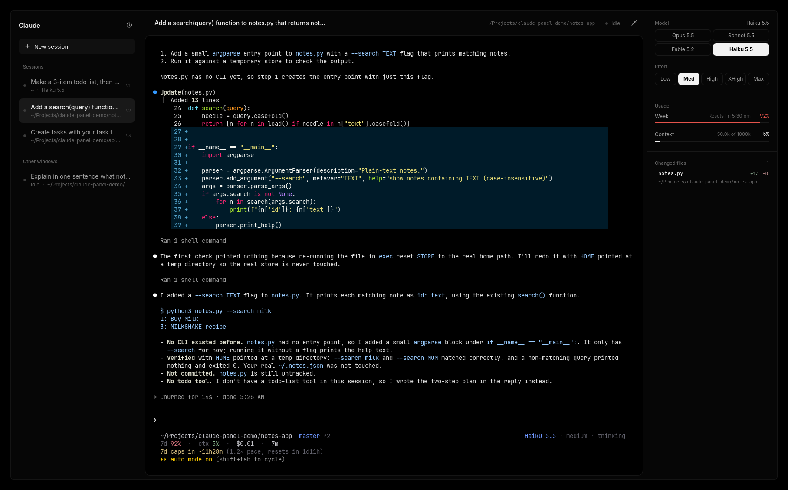
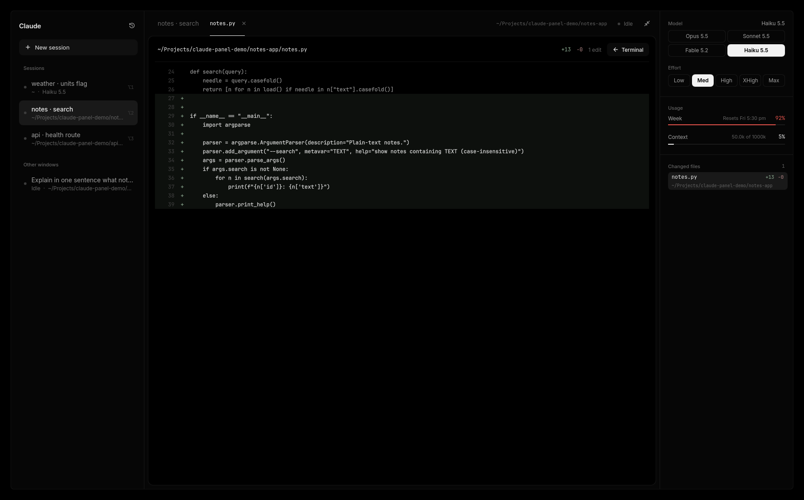
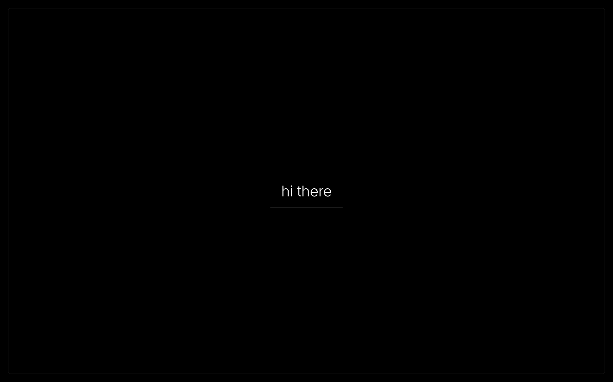

<div align="center">

<picture>
  <source media="(prefers-color-scheme: dark)" srcset="docs/logo-dark.svg">
  
</picture>

# claude-panel

**One quiet window for every Claude Code session you run.**

A control panel for Claude Code on Hyprland, built with Quickshell for the
[Caelestia](https://github.com/caelestia-dots/shell) desktop.

<br>



</div>

<br>

## What it does

**Runs real sessions, side by side.** Each session in the panel is the actual `claude` CLI in a terminal, not a
re-implementation. The sessions you are not looking at keep working. Switch with a click or `Alt + 1…9`.

**Sees the rest of your sessions.** Claude Code sessions running in normal terminals are listed under
*Other windows*, with their `/rename` name, status and last activity. Click one to jump to its window.

**Keeps the controls next to the terminal:**

| | |
|---|---|
| **Model & effort** | Opus, Sonnet, Fable or Haiku, and effort from Low to Max. A switch relaunches the *same* conversation with the new flags. Your saved default is never changed. |
| **Usage & context** | Plan usage for the 5-hour and weekly windows, plus context use. Both turn red from 80%. |
| **Changed files** | Every file Claude edited in the session, with a diff view one click away. |
| **Tasks** | Claude's task list, when it keeps one. |
| **History** | Resume any past conversation in the panel. |
| **Notifications** | Sent when a session finishes or needs you while you are looking elsewhere. |

**Stays out of trouble.**

- Open sessions survive a restart and resume where they left off, with the same model, effort and changed-file list.
- A conversation that is already open in another window is never started a second time. The panel offers to jump there instead.
- The panel answers Claude's "do you trust this folder?" question for folders that ask. Your home folder asks every time.

<br>

<div align="center">
&nbsp;

</div>

<br>

## Keys

| Key | |
|---|---|
| <kbd>Super</kbd> <kbd>A</kbd> | Open here, hide when focused, or jump to it from another workspace |
| <kbd>Super</kbd> <kbd>Shift</kbd> <kbd>A</kbd> | Close for good. Sessions end and resume the next time you open it |
| <kbd>Alt</kbd> <kbd>1…9</kbd> | Switch session |
| <kbd>Ctrl</kbd> <kbd>Shift</kbd> <kbd>C</kbd> / <kbd>V</kbd> | Copy and paste in the terminal |

The panel is a normal window, so it stays on the workspace where you opened it.

## Install

**Requirements**

- Hyprland (Lua or classic config) and [Quickshell](https://quickshell.org)
- `qmltermwidget`, the Qt 6 build. On Arch: `sudo pacman -S qmltermwidget`
- [Claude Code](https://docs.claude.com/en/docs/claude-code) 2.1 or newer
- `python3` and `jq`
- The fonts Inter, JetBrainsMono Nerd Font and Material Symbols Rounded. Caelestia ships all three.

**Steps**

```sh
git clone https://github.com/raaixd/claude-panel
cd claude-panel
./install.sh --bind
```

`--bind` adds the two keys to `~/.config/caelestia/hypr-user.lua`, or to `.conf` if that's what you use.
On any other Hyprland setup, add the keys yourself:

```lua
-- Lua config
hl.bind("SUPER + A",         hl.dsp.exec_cmd(os.getenv("HOME") .. "/.local/bin/claude-panel"))
hl.bind("SUPER + SHIFT + A", hl.dsp.exec_cmd(os.getenv("HOME") .. "/.local/bin/claude-panel quit"))
```

```ini
# hyprland.conf
bind = SUPER, A,       exec, ~/.local/bin/claude-panel
bind = SUPER SHIFT, A, exec, ~/.local/bin/claude-panel quit
```

To uninstall, run `./install.sh --remove`.

## Settings

All settings are environment variables. Set them where your Hyprland session gets its environment.

| Variable | |
|---|---|
| `CLAUDE_PANEL_NAME` | The name in the greeting. Defaults to your login name. |
| `CLAUDE_PANEL_OTHERS_UNDER` | Only list other-window sessions whose folder is under this path. |
| `CLAUDE_CONFIG_DIR` | Respected if you keep Claude Code's config somewhere other than `~/.claude`. |

To see a frosted look behind the window, enable blur for transparent windows in your Hyprland decoration settings.

## How it works

```
claude-panel ─▶ Quickshell window (shell.qml)
                 └─ one Session.qml per session ─▶ Term.qml (qmltermwidget) ─▶ launch.sh ─▶ claude
                                                                                     │
                     events.jsonl / status.json  ◀── bridge.py ◀── hooks + status line ┘
```

- `launch.sh` starts `claude` with `--settings <file>`. That file adds hooks and a status line for that session
  only, so your `~/.claude/settings.json` is never touched.
- `bridge.py` is what those hooks call. It records prompts, stops, file edits with diffs and tasks to
  `$XDG_RUNTIME_DIR/claude-panel/s/<session>/`. If you have `~/.claude/statusline-command.sh`, it still runs.
- Other windows come from `~/.claude/sessions/<pid>.json`, which Claude Code keeps for every running session.
- The list of open sessions is saved to `~/.local/state/claude-panel/sessions.json`.

Nothing leaves your machine. The panel contains no network code.

## Notes

- **Editing the panel's files:** changes apply the next time it starts. Press <kbd>Super</kbd> <kbd>Shift</kbd> <kbd>A</kbd>, then <kbd>Super</kbd> <kbd>A</kbd>.
- **Memory:** a panel session uses about as much as Claude Code in a terminal, around 250 MB. The window itself uses around 200 MB.
- **Terminal colours:** `schemes/DarkPastels.colorscheme` is a muted black palette kept under a stock name, because qmltermwidget only loads scheme names it already knows.

## License

[MIT](LICENSE)
